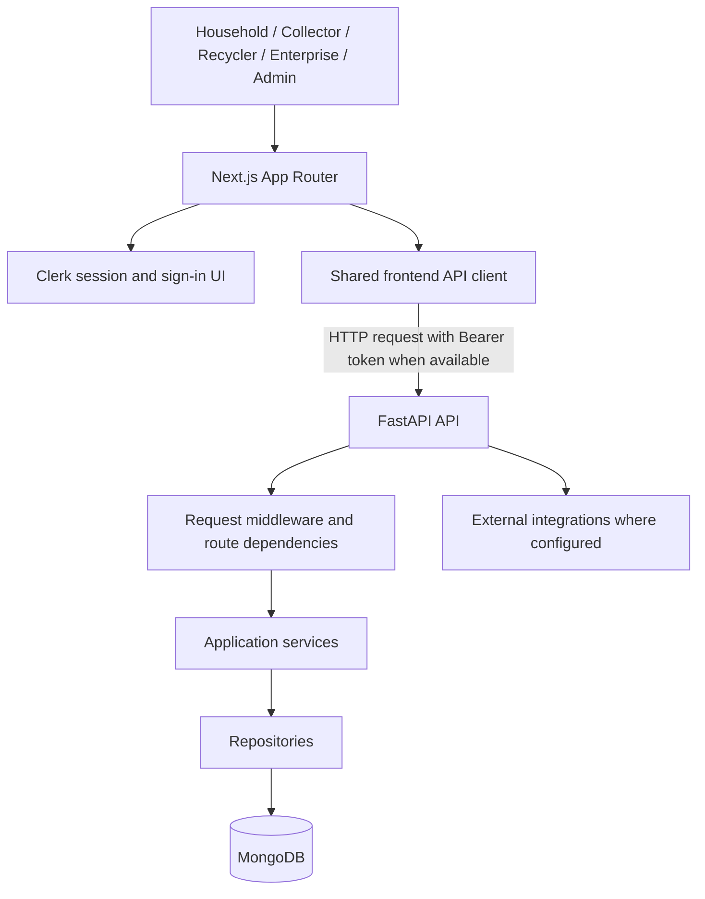

# Architecture overview

This document describes the current repository structure and the main request path. It is intended to help a developer understand where to look before changing the application.

## At a glance

RecycleX is organised as a Next.js frontend and a FastAPI backend. The frontend owns the user-facing workspaces and calls the backend through a shared API client. The backend exposes versioned routes and keeps request handling, validation, application logic and persistence in separate modules.

The diagram is a logical view of the codebase. It does not imply that every external integration is enabled in every environment.

## Frontend

The frontend is under `frontend/` and uses Next.js App Router, React, TypeScript and Tailwind CSS.

Useful locations:

| Path | Responsibility |
| --- | --- |
| `frontend/app/` | Pages and role-based route groups |
| `frontend/components/` | Shared UI and layout components |
| `frontend/lib/api/client.ts` | Shared HTTP client, API base URL selection and token attachment |
| `frontend/lib/api/` | Endpoint-specific API functions |
| `frontend/middleware.ts` | Route matching and Clerk session protection |

The shared API client resolves the backend base URL from `NEXT_PUBLIC_API_URL` and includes a Clerk session token in the `Authorization: Bearer` header when a token getter is configured or the Clerk session fallback is available. Endpoint modules call this client rather than implementing their own transport.

## Backend

The backend is under `backend/app/` and is built with FastAPI.

| Path | Responsibility |
| --- | --- |
| `api/v1/` | HTTP route definitions and API router |
| `schemas/` | Request and response validation |
| `services/` | Application and workflow logic |
| `repositories/` | Database access |
| `models/` | User and domain data models |
| `db/` | MongoDB connection lifecycle |
| `core/config.py` | Environment-driven settings |
| `core/security.py` | Authentication dependencies and role checks |
| `middleware/` | Request identification and error handling |

The versioned router is assembled in `backend/app/api/v1/router.py`. The application factory and middleware registration are in `backend/app/main.py`.

## Main role areas

The application has five role values represented in the product and backend:

- **HOUSEHOLD** — household listings, pickups, profile and impact-related pages.
- **COLLECTOR** — collection activity, pickups, inventory, maps and marketplace workflows.
- **RECYCLER** — recycler marketplace, supplier, order and profile workflows.
- **ENTERPRISE** — business-side material and operational workflows.
- **ADMIN** — administrative functions.

The frontend has separate individual and business portal entry points. Backend role dependencies are used to restrict selected operations. A route existing in the frontend does not by itself establish that the corresponding feature is complete or enabled for all users.

## Request and identity flow

A typical authenticated frontend request follows this sequence:

1. A user signs in through the Clerk integration used by the frontend.
2. The frontend obtains a session token when the shared API client needs one.
3. The API client sends the request to the configured FastAPI base URL and includes the token in the bearer authorization header when available.
4. FastAPI route dependencies handle authentication and obtain the local user context used by protected operations.
5. The authentication synchronisation route and service maintain the relationship between the Clerk identity, the local user record and the user's profile.
6. The relevant service and repository perform the requested application or database operation.

The exact checks performed by the backend are implementation details and should be reviewed in the authentication code before changing identity or role behaviour.

### Authentication maintenance note

Clerk is the identity provider integrated into the frontend, and the backend contains JWT claim handling, user synchronisation and role-aware dependencies. Before relying on this flow as a production security boundary, maintainers should independently verify token signature, issuer, audience and expiry validation, and confirm that role values are derived from trusted identity data rather than accepted solely from client-submitted fields. This document is an architecture guide, not a security certification.

## API route families

The backend exposes routes under `/api/v1`. Current route modules include:

| Route family | Module | Purpose |
| --- | --- | --- |
| Health | `health.py` | API and database connectivity |
| Authentication | `auth.py` | Clerk identity synchronisation |
| Users and profiles | `users.py`, `profiles.py` | User and profile records |
| Listings and addresses | `listings.py`, `addresses.py` | Material listing and address workflows |
| Pickups and collector | `pickups.py`, `collector.py` | Collection coordination |
| Marketplace and orders | `marketplace.py`, `orders.py`, `recycler.py` | Material marketplace and order workflows |
| AI and storage | `ai.py`, `storage.py` | AI-assisted analysis and file handling |
| Notifications and impact | `notifications.py`, `impact.py` | User updates and impact information |

The interactive API schema is served by FastAPI at `/docs` when the backend is running.

## Data layer

The backend uses MongoDB through Motor/PyMongo. Repository classes provide the data-access boundary used by services. Database connection setup and shutdown are managed by the FastAPI application lifespan.

Use a dedicated development database when running the application locally. Do not run seed, reset or migration-like scripts against the live database unless the operation has been separately reviewed and explicitly intended.

## External services and configuration

The repository contains configuration for services such as Clerk, MongoDB, Google Maps, file storage, AI services, email and observability. A configured variable or service module does not necessarily mean the corresponding integration is active in every environment.

- Keep private API keys and database credentials in server-side environment variables.
- Variables prefixed with `NEXT_PUBLIC_` are available to browser code and must be treated as public.
- Restrict browser-facing API keys by allowed origins and enabled APIs in the provider's console.
- Do not commit local `.env` files or production credentials.

For exact local setup steps, see [Local development](local-development.md).
